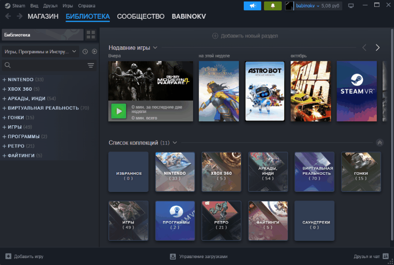
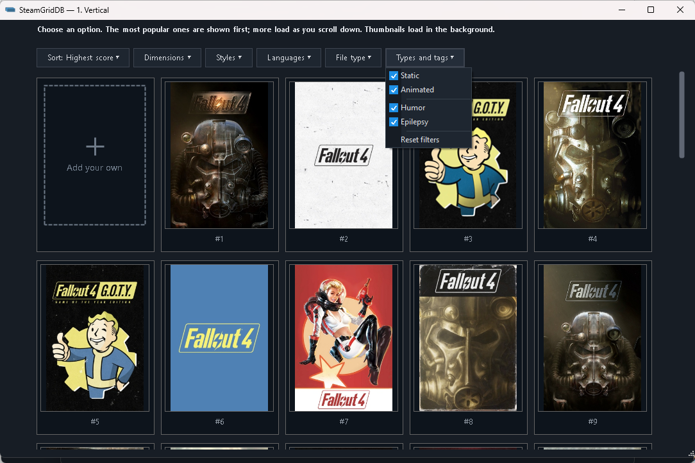
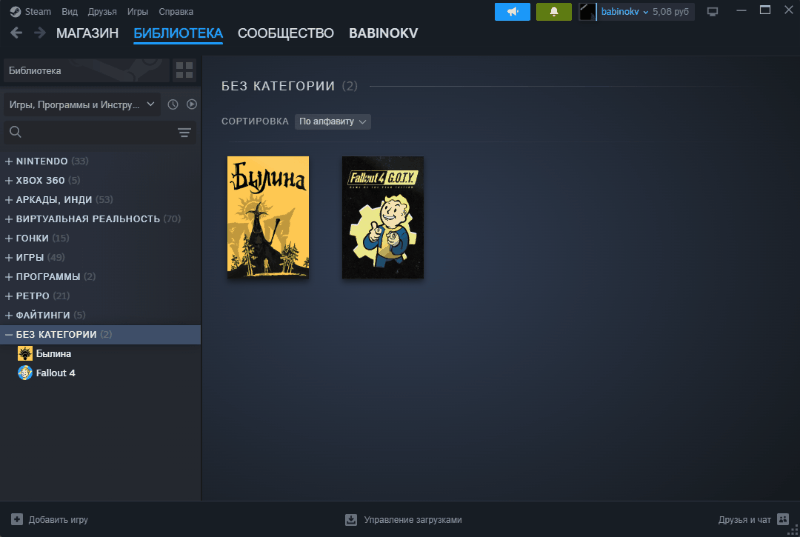
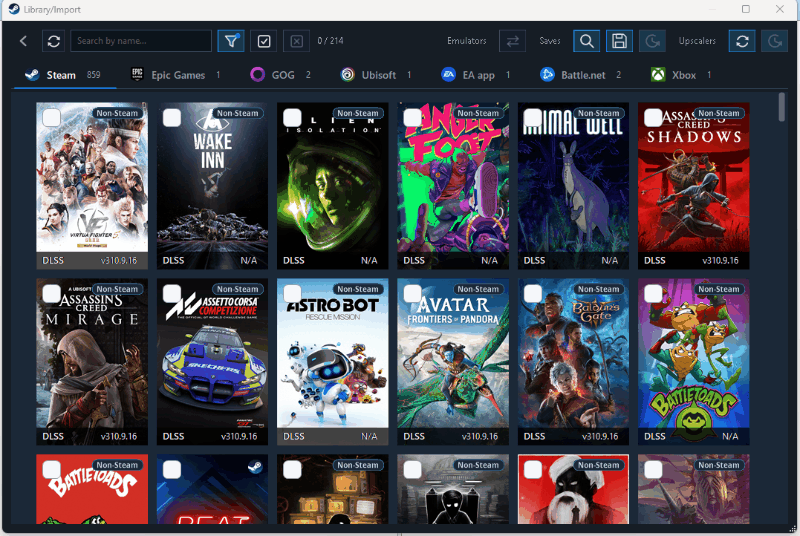
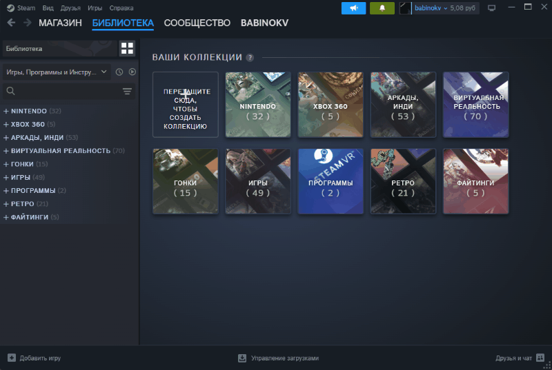
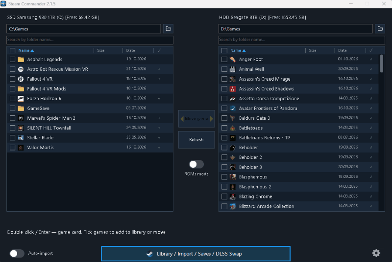
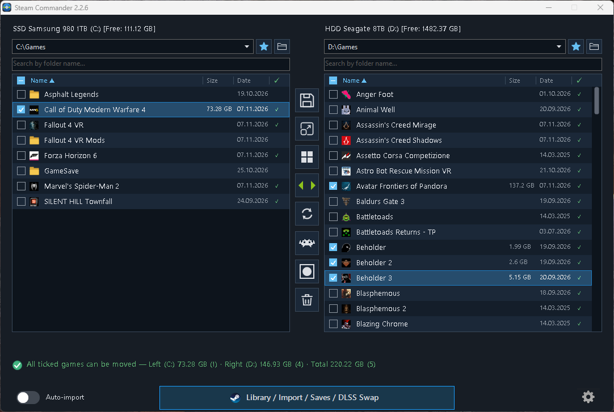

<div align="center">


# Steam Commander

**Everything for non-Steam games in one program: adding games and ROMs (including multi-disc ones), launching through wrappers (Virtual Desktop and others), importing from Epic / GOG / Ubisoft / EA / Battle.net / Xbox, Steam collections, covers (including animated ones) from Steam and SteamGridDB, save backups, DLSS / FSR / XeSS / XeLL updates, and easy moving of games between drives.**


[](https://github.com/Hetfield1985/Steam-Commander/releases)

---

[](https://github.com/Hetfield1985/Steam-Commander/releases/latest)

<p align="center">
  <a href="https://donatty.com/vitalibabinok"></a>
  <a href="https://destream.net/live/VitaliBabinok"></a>
  <a href="https://boosty.to/babinok/donate"></a>
  <a href="#support"></a>
</p>

<p align="center">
  <a href="README.ru.md">Русский</a> · <b>English</b>
</p>

---

</div>

## Contents

- [Features](#features)
- [System requirements](#system-requirements)
- [Installation](#installation)
- [First-time setup](#first-time-setup)
- [Keyboard shortcuts](#keyboard-shortcuts)
- [Where data is stored](#where-data-is-stored)
- [Privacy and network](#privacy-and-network)
- [Known limitations](#known-limitations)
- [Support](#support)

---

## Features

### Adding games to Steam

Adds non-Steam games to your Steam library with automatic detection of the title and EXE file, a convenient choice of the official launch options (or your own), and a full set of covers from two sources: Steam and SteamGridDB. You can add games one by one through the card or in batches: everything the program is sure about is filled in automatically, and it asks you only about the rest.

The built-in database of Steam game titles makes the search more accurate. It holds the games known at the time the program was built; to find new releases accurately, get your own Steam Web API key and enter it in the settings.

From the card you can start the game right away with the **Launch** button: it starts exactly what the card shows (the chosen EXE or emulator, ROM and launch options), even if the game has not been saved yet.

<p align="center">
  
</p>

### Covers: Steam, SteamGridDB and animation

- **Two sources:** official Steam covers (with region choice) and community covers from SteamGridDB, for four slots: vertical, horizontal, background (hero) and logo, plus the icon.
- **Animated covers.** GIF, APNG and animated WebP are supported: the animation plays in the card, in the Library tiles and in the SteamGridDB chooser. The cover file itself is not changed and is passed to Steam as is (animated files are saved to `config\grid` with the `.png` name, which is how Steam reads them). For WebP the program downloads the libwebp tools once.
- **SteamGridDB chooser.** The "by popularity" order matches steamgriddb.com. Sorting: by score, newest first, oldest first, and for ROMs, covers of the matching platform first. Filters as on the site: sizes, styles, languages, file type and tags (static, animated, humor, 18+, epilepsy). Options load as you scroll, and thumbnails are downloaded in the background with retries on failure. Badges under the tiles show an animated cover, an author comment (the text is in the tooltip) and the number of likes.
- **Your own images.** The "Choose your own" tile accepts PNG, JPG, GIF, APNG, WebP, ICO and other formats; the game's EXE icons are offered automatically.
- **Logo as in Steam.** The logo position and size are taken from the game's developer, and when adjusted by hand the logo snaps to the five Steam positions (with hints while dragging). The frame button shows the background the way the Steam client draws it.
- **Fast downloads.** The fastest of the Steam CDN mirrors (akamai, fastly, cloudflare) is chosen automatically, and four covers are downloaded in parallel.

<p align="center">
  
</p>

### Import from launchers

Epic Games, GOG Galaxy, Ubisoft Connect, EA App, Battle.net, Xbox. Imports the ticked games into Steam (manually or automatically); you can build the selection from several launchers at once and import it with one button. Covers are set up in the same way as for ordinary games. Games are started by the program's own quiet launcher: it makes sure the third-party launcher starts in quiet mode, moves focus to the game and closes the third-party launcher after you quit the game. It feels as if you were playing an ordinary Steam game.

<p align="center">
  
</p>

### Automatic import

For those who want to save time: with auto-import turned on, games are added in large batches, very quickly and without your involvement. You only need to confirm the data the program could not determine with confidence. An example with ordinary games is shown in the GIF in the "Adding games to Steam" section.

### Game saves: backup and restore

- **Finding saves without starting the game.** Paths come from the official Ludusavi database (MIT license, built into the program, updated from the settings), from known Steam emulator paths (including non-licensed game copies), from Steam Cloud and from heuristics. For games missing from the database there is a detector: it starts the game, watches the files it creates and suggests the most likely folders.
- **Backup and restore** for one game (buttons in the card and tile menu items) or for all ticked games at once (the **Saves** group in the Library window). Copies are stored in zip archives; if the saves have not changed, no new archive is created. Before a restore, the current saves are automatically put aside into a safety `pre-restore` archive, and if there are several copies you can choose the one you need.
- The common backup folder is chosen in the settings. ROMs do not take part in this feature.

<p align="center">
  
</p>

### Adding ROMs with emulator choice

The panels show folders and ROM files by the extensions of the active emulator. Emulator manager, RetroArch support with core selection, archives (zip, 7z, rar and others) unpacked to a temporary folder, and your own emulator launch options (for example, full screen). When an emulator profile is changed, the program finds all shortcuts that use it and offers to update them at once. The emulator of already added ROMs can be changed in Library with a single action, without opening the card, and SteamGridDB covers for ROMs are chosen with the platform in mind.

- **Ready presets** of emulators with launch options (DuckStation, PPSSPP, mGBA, Mesen, MAME, Xenia, Ryujinx and others, and the DOS platform with DOSBox / DOSBox-X / DOSBox Staging).
- **RetroArch cores.** When a ROM is picked, the extensions the core really opens are taken into account: other files go to the end of the list and are not chosen automatically (also inside archives).
- **Multi-disc games (m3u).** The *Multi-disc (m3u)* tick in the emulator profile (on by default for RetroArch, DuckStation, Mednafen, Flycast and BizHawk). Discs named like `(Disc 1)` or `[CD2]` are found automatically and added as one entry. In the card, the *Discs...* window lets you build or fix the list by hand (add, remove, reorder). The m3u files are stored in `%APPDATA%\Steam Commander\m3u`, nothing is written into the ROM folder, and when the discs are moved the paths inside the m3u are updated.

<p align="center">
  
</p>

### Launch wrappers

Wrappers let you start an ordinary game through a helper program: Virtual Desktop Streamer, Sandboxie, Locale Emulator, compatibility modes, high priority and so on. In the Steam shortcut the launched file becomes the wrapper, and its arguments are built from a template (`{game}` is the path to the game, `{args}` is your launch options from the card). Wrappers are configured in **Settings**, in the *Wrappers* section: it has a list of ready presets, and you can add and edit your own.

- **Card.** A tick with a dropdown of wrappers to the right of the launch options; the choice is saved in the shortcut and restored when the card is opened again.
- **Main window.** The *Wrappers* switch under *ROMs* (only one of the two can be on): games you add go through the active wrapper, and already added ticked games can be switched to it.
- **Library.** The *Wrappers* category in the filter with a separate tick for every wrapper, and the right-click items *Change wrapper* and *Remove wrapper* for one or all ticked games. ROMs and launcher games (`SCLauncher.exe`) are not touched; the icon comes from the game itself, not from the wrapper.

### Updating and managing upscaler libraries

Downloading and choosing versions of DLSS / FSR / XeSS / XeLL. Replacing the libraries in the selected games (or in all added ones) with one button, optionally automatically when a game is added to Steam. After the operation a detailed report for each game is shown. Originals are kept as `.sc_orig` and can be restored in one action.

<p align="center">
  
</p>

### Two-panel browser

Two independent panels (any folders and drives). Search, sorting, folder size, an "already in Steam" mark with the game icon. Moving game and ROM folders between the panels with progress and automatic updating of the Steam shortcuts. Smart moving in both directions between folders and drives: tick games on both panels and press Space to find out whether such a move is possible and how much space is missing.

<p align="center">
  
</p>

### Steam collections

In the Library window, to the right of the *Filter* button, there is a collection dropdown (as in Steam): *All collections*, your collections with the number of games, and *Uncategorized*. The right-click *Collections* item opens a window with check boxes for one or all ticked games (a square means that only some of the games are in the collection). To write the changes the program closes Steam, updates `localconfig.vdf` and `cloud-storage-namespace-1.json`, and starts Steam again; copies of both files are saved first (the last 10 are kept). Dynamic collections are skipped, because Steam builds them itself.

### Library editing

Editing non-Steam games, ROMs and licensed Steam games (covers, launch options). Automatic and manual backup and restore of `shortcuts.vdf` (the file that stores the library of third-party games). Steam restart mode in the settings: **automatic** (the program closes and starts Steam itself) or **manual** (you decide when to restart Steam, and the program correctly writes `shortcuts.vdf` after it is closed).

### More

- **"Open on startup"** setting: file panels or the Library window; the column widths of the lists are remembered.
- Six interface languages: Русский, English, 简体中文, Español, Português (Brasil), Deutsch; you can add your own language files.
- Fast start and smooth work with large libraries: lists and tiles are built in portions, scrolling does not freeze, and a repeated start is sped up by a cache of compiled blocks.
- No telemetry.

---

## System requirements

- Windows 10 or 11
- Windows PowerShell 5.1 (only when running the `.ps1`)
- Steam installed (started at least once)
- **Administrator rights**
- Internet: for searching games, covers, save databases and downloading upscalers
- Optional but recommended: a [Steam Web API key](https://steamcommunity.com/dev/apikey), and for choosing community covers a [SteamGridDB API key](https://www.steamgriddb.com/profile/preferences) is strongly recommended
- For ROM archives: 7-Zip (the program can offer to download it)

---

## Installation

### Ready exe
1. Download `Steam Commander.exe` from the [Releases](../../releases) page
2. Run it (the program asks for administrator rights)

### Script
```powershell
# PowerShell as administrator
powershell -ExecutionPolicy Bypass -File .\src\Steam_Commander.ps1
```

### Building the exe
```powershell
Install-Module ps2exe -Scope CurrentUser   # once
.\build\build.ps1
```
Result: `dist\Steam Commander.exe`.

---

## First-time setup

1. Open **Settings** and specify the Steam folder and the `userdata` profile
2. *(Optional)* Add the Steam Web API and SteamGridDB API keys
3. If needed, download the upscaler libraries, update the save database and choose the common folder for save backups
4. For ROMs, add emulator profiles with the exe path
5. To launch through Virtual Desktop and similar programs, check the paths in the *Wrappers* section
6. Choose the Steam restart mode: automatic or manual

> Steam must be closed while `shortcuts.vdf` is being written: in automatic mode the program closes it and starts it again. Close your games and wait for Steam to finish syncing before the operation.

---

## Keyboard shortcuts

| Key | Action |
|---|---|
| Double click / **Enter** | Open the game card |
| **Space** | Size of the ticked game folders, and a check of whether these games can be moved between the panels |
| **Ctrl+A** | Select all folders and files in the panel |
| **Esc** | Close the game card or window |
| **Alt+Shift+Enter** | Size of all folders in the panel |
| **F5** | Refresh the panels / Library window |

---

## Where data is stored

| What | Where |
|---|---|
| Settings, emulator profiles | `%APPDATA%\Steam Commander` |
| Steam game database | `%APPDATA%\Steam Commander\steam_apps_db.json` |
| Upscaler libraries | `%APPDATA%\Steam Commander` |
| Save database (Ludusavi) | `%APPDATA%\Steam Commander\saves` |
| Save backups | the folder chosen in the settings (by default `%APPDATA%\Steam Commander\saves\backups`) |
| WebP tools (libwebp), ffmpeg if needed | `%APPDATA%\Steam Commander\libwebp`, `%APPDATA%\Steam Commander\ffmpeg` |
| Cache of compiled blocks | `%LOCALAPPDATA%\SteamCommander\typecache` |
| Language files | `%APPDATA%\Steam Commander\lang` |
| m3u disc lists | `%APPDATA%\Steam Commander\m3u` |
| `shortcuts.vdf` backups | the `backups` folder next to the exe |
| Collection file backups | `backups\collections` (the last 10) |
| Temporary files | `%TEMP%\SteamCommander` |
| Steam shortcuts and covers | `Steam\userdata\<id>\config\` |

API keys are stored in plain text in `config.ini`, do not share this file.

---

## Privacy and network

No telemetry. The program contacts only:

- `store.steampowered.com`, `api.steampowered.com`, `*.steamstatic.com`, `steamcdn-a.akamaihd.net` (Steam data and covers)
- `api.steamcmd.net`
- `www.steamgriddb.com` and its CDN (covers, when a key is set)
- `raw.githubusercontent.com` (the fresh Ludusavi save database, only on the update button) and `github.com`
- the upscaler library sources of DLSS Swapper
- `storage.googleapis.com` (libwebp tools for WebP, once), `www.7-zip.org` (7-Zip for archives, on request), `www.gyan.dev` and `github.com` (ffmpeg, only if needed for WebM previews)
- launcher services (GOG, Ubisoft, Microsoft Store) for the titles and covers of imported games

---

## Project structure

```text
Steam-Commander/
├── src/Steam_Commander.ps1
├── build/build.ps1
├── assets/icon/
├── .github/
├── CHANGELOG.md
├── CONTRIBUTING.md
└── LICENSE
```

---

## Known limitations

- Steam covers may be missing for new or little-known games: searching the SteamGridDB databases helps
- Title matching is heuristic; the confidence indicators show when the data should be checked by hand
- Import from launchers depends on the data format of each launcher
- Save search relies on the Ludusavi database and heuristics: for rare games you may have to confirm the path by hand
- Animated covers are decoded in the background, so heavy files do not start playing at once
- Steam collections are written only while Steam is closed; dynamic collections are not supported
- Windows only

---

## Contributing

Bug reports and pull requests are welcome, see [CONTRIBUTING.md](CONTRIBUTING.md).  
You can add language files to the `lang` folder. Change history: [CHANGELOG.md](CHANGELOG.md).

---

## Disclaimer

Steam Commander is an unofficial community project. It is not affiliated with Valve Corporation.  
*Steam* and the Steam logo are trademarks of Valve Corporation.  
Covers belong to their owners. The application icon is an original design.  
The save database is based on the [Ludusavi Manifest](https://github.com/mtkennerly/ludusavi-manifest) (MIT).

The program modifies `shortcuts.vdf`, can replace upscaler DLLs and can overwrite save files when restoring. Use at your own risk. Make a backup before bulk operations.

---

## License

[MIT](LICENSE)

---

## Support

If the program turned out to be useful:

- [Donatty](https://donatty.com/vitalibabinok)
- [DeStream](https://destream.net/live/VitaliBabinok)
- [Boosty](https://boosty.to/babinok/donate)

**USDT** (minimum 5 USDT):

- ERC-20: `0x2503cdb205ac6e41222e114d77b0dcc48ed83686`
- TRC-20: `TSE4BZQC6h9qES2QsgJjcfyDbGYNDATSv4`
- BEP-20: `0x2503cdb205ac6e41222e114d77b0dcc48ed83686`

Send only through the network specified. Transfers under 5 USDT or through another network will be lost.
