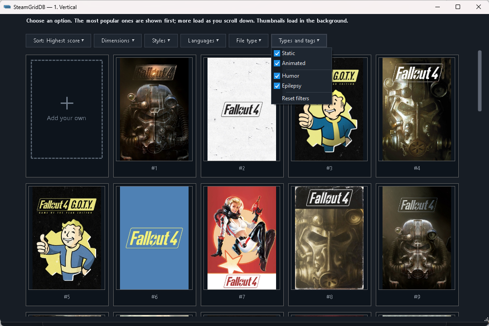
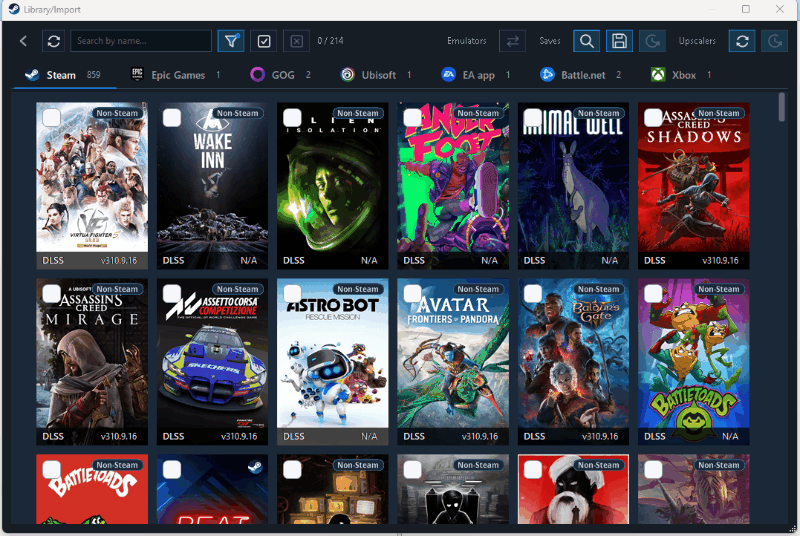
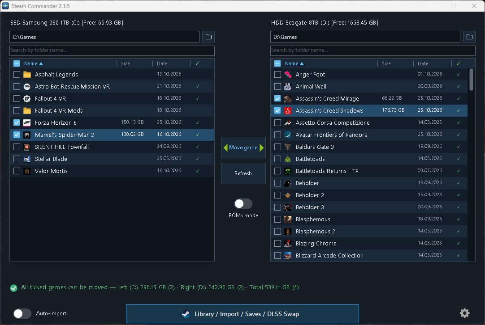

<div align="center">


# Steam Commander

**Everything for non-Steam games in one program: add games and ROMs to Steam, import from Epic / GOG / Ubisoft / EA / Battle.net / Xbox, set covers (animated ones too) from Steam and SteamGridDB, back up game saves, update DLSS / FSR / XeSS / XeLL, and move games between drives in a convenient two-panel browser.**


[](https://github.com/Hetfield1985/Steam-Commander/releases)

---

[](https://github.com/Hetfield1985/Steam-Commander/releases/latest)

<p align="center">
  <a href="https://donatty.com/vitalibabinok"></a>
  <a href="https://destream.net/live/VitaliBabinok"></a>
  <a href="https://boosty.to/babinok/donate"></a>
  <a href="#support"></a>
</p>

<p align="center">
  <a href="README.ru.md">Русский</a> · <b>English</b>
</p>

---

</div>

## Contents

- [Features](#features)
- [System requirements](#system-requirements)
- [Installation](#installation)
- [First-time setup](#first-time-setup)
- [Keyboard shortcuts](#keyboard-shortcuts)
- [Where data is stored](#where-data-is-stored)
- [Privacy and network](#privacy-and-network)
- [Known limitations](#known-limitations)
- [Support](#support)

---

## Features

### Adding games to Steam

Add non-Steam games to your Steam library with automatic detection of the title and the EXE file, a convenient choice of official launch options (or your own), and a full set of covers from two sources: Steam and SteamGridDB. Add games one by one through the game card or in batches: everything the program is confident about is filled in automatically, and it asks you only for what it could not determine.

The built-in Steam title database makes matching more accurate. It contains the games that existed when the program was built; to find new releases precisely, get your own Steam Web API key and enter it in Settings.

From the card you can launch the game right away with the **Launch** button. It starts exactly what the card shows (the selected EXE or emulator, the ROM, the launch options), even if the game is not saved yet.

<p align="center">
  
</p>

### Covers: Steam, SteamGridDB and animation

- **Two sources:** official Steam artwork (with region selection) and community artwork from SteamGridDB, for four slots: vertical cover, horizontal cover, background (hero) and logo, plus the icon.
- **Animated covers.** GIF, APNG and animated WebP are supported: the animation plays in the game card, in Library tiles and in the SteamGridDB chooser. The cover file itself is never changed and goes to Steam as it is (animated files are saved in `config\grid` under a `.png` name, which is how Steam accepts them). For WebP the program downloads the libwebp tools once.
- **SteamGridDB chooser.** The "most popular first" order matches steamgriddb.com. Sorting: by score, newest first, oldest first and, for ROMs, covers of the ROM's platform first. Filters like on the site: dimensions, styles, languages, file type and tags (static, animated, humor, adult, epilepsy). Options load as you scroll, and thumbnails download in the background with retries on failure.
- **Your own images.** The *Choose your own* tile accepts PNG, JPG, GIF, APNG, WebP, ICO and other formats; the icons of the game's EXE are offered automatically.
- **Logo like in Steam.** The logo position and size set by the game's developer are used, and when you drag the logo by hand it snaps to Steam's five positions (with marks shown while dragging). A framing button shows the background the way the Steam client draws it.
- **Fast downloads.** The fastest of the Steam CDN mirrors (akamai, fastly, cloudflare) is chosen automatically, and the four covers of a game download in parallel.

<p align="center">
  
</p>

### Importing from launchers

Epic Games, GOG Galaxy, Ubisoft Connect, EA App, Battle.net, Xbox. Import the ticked games into Steam (manual or automatic); you can build one selection from several launchers and import it with a single button. Covers are customised the same way as for ordinary games. Launching goes through the program's own quiet launcher: it makes sure the third-party launcher starts in quiet mode, brings the game to the foreground and closes the launcher after you quit the game. It feels as if you were playing a regular Steam game.

<p align="center">
  
</p>

### Automatic import

For those who want to save time: with auto-import on, games are added in large batches, very quickly and without your involvement. You only need to clarify the data the program could not determine with confidence. An example with ordinary games is shown in the GIF in the "Adding games to Steam" section.

### Game saves: backup and restore

- **Finding saves without launching the game.** Locations come from the official Ludusavi database (MIT, built into the program and updatable from Settings), from the known paths of Steam emulators (including those used by non-licensed copies of games), from Steam Cloud and by heuristics. For games that are not in the database there is a detector: it launches the game, watches the files it creates and suggests the most likely folders.
- **Backup and restore** for a single game (buttons in the card and items in the tile menu) or for all ticked games at once (the **Saves** group in the Library window). Backups are zip archives; if the saves did not change, no new archive is created. Before a restore, the current saves are put into a `pre-restore` safety archive, and if there are several backups you can pick the one you need.
- The common backup folder is chosen in Settings. ROMs are not part of this feature.

<p align="center">
  
</p>

### Adding ROMs with an emulator of your choice

The panels show folders and ROM files by the extensions of the active emulator. Emulator manager, RetroArch support with core selection, archives (zip, 7z, rar and others) extracted to a temporary folder, and your own emulator launch options (for example, full screen). When you change an emulator profile, the program finds every shortcut that uses it and offers to update them all at once. The emulator of ROMs already in Steam can be changed from Library in one action without opening a card, and SteamGridDB covers for ROMs are picked with the platform in mind.

<p align="center">
  
</p>

### Updating and managing upscaler libraries

Download and select versions of DLSS / FSR / XeSS / XeLL. Replace the libraries in the selected games (or in all added ones) with one button, optionally automatically when a game is added to Steam. After the operation a detailed report for every game is shown. Originals are kept as `.sc_orig` and can be restored in one action.

<p align="center">
  
</p>

### Two-panel browser

Two independent panels (any folders and drives). Search, sorting, folder sizes and an "already in Steam" marker with the game's icon. Move game and ROM folders between the panels with progress and automatic updating of Steam shortcuts. Smart two-way moves between folders and drives: tick games on both panels and press Space to see whether such a move is possible and how much space is missing.

<p align="center">
  
</p>

### Library editing

Edit non-Steam games, ROMs and licensed Steam games (covers, launch options). Automatic and manual backup and restore of `shortcuts.vdf` (the file that holds your non-Steam library). The Steam restart mode in Settings: **automatic** (the program closes and starts Steam itself) or **manual** (you decide when to restart Steam, and the program writes `shortcuts.vdf` correctly after Steam closes).

### Also

- Six interface languages: Русский, English, 简体中文, Español, Português (Brasil), Deutsch; you can add your own language files.
- Smooth work with large libraries: lists and tiles are built in portions, scrolling does not stutter, and later starts are faster thanks to a cache of compiled blocks.
- No telemetry.

---

## System requirements

- Windows 10 or 11
- Windows PowerShell 5.1 (only when running the `.ps1`)
- Steam installed (started at least once)
- **Administrator rights**
- Internet: for searching games and covers, saves databases and downloading upscalers
- Optional but recommended: a [Steam Web API key](https://steamcommunity.com/dev/apikey); a [SteamGridDB API key](https://www.steamgriddb.com/profile/preferences) is strongly recommended for community covers
- For ROM archives: 7-Zip (the program can offer to download it)

---

## Installation

### Ready-made exe
1. Download `Steam Commander.exe` from the [Releases](../../releases) page
2. Run it (the program asks for administrator rights)

### Script
```powershell
# PowerShell as administrator
powershell -ExecutionPolicy Bypass -File .\src\Steam_Commander.ps1
```

### Building the exe
```powershell
Install-Module ps2exe -Scope CurrentUser   # once
.\build\build.ps1
```
The result is `dist\Steam Commander.exe`.

---

## First-time setup

1. Open **Settings** and set the Steam folder and the `userdata` profile
2. *(Optional)* Add the Steam Web API and SteamGridDB API keys
3. If needed, download the upscaler libraries, update the saves database and choose a common folder for save backups
4. For ROMs, add emulator profiles with the path to the exe
5. Choose the Steam restart mode: automatic or manual

> Steam has to be closed while `shortcuts.vdf` is written: in the automatic mode the program closes it and starts it again. Close your games and wait for Steam to finish syncing before the operation.

---

## Keyboard shortcuts

| Key | Action |
|---|---|
| Double click / **Enter** | Open the game card |
| **Space** | Size of the ticked folders, and a check whether these games can be moved between the panels |
| **Ctrl+A** | Select all folders and files in the panel |
| **Esc** | Close the game card or window |
| **Alt+Shift+Enter** | Size of all folders in the panel |
| **F5** | Refresh the panels / the Library window |

---

## Where data is stored

| What | Where |
|---|---|
| Settings, emulator profiles | `%APPDATA%\Steam Commander` |
| Steam games database | `%APPDATA%\Steam Commander\steam_apps_db.json` |
| Upscaler libraries | `%APPDATA%\Steam Commander` |
| Saves database (Ludusavi) | `%APPDATA%\Steam Commander\saves` |
| Save backups | the folder chosen in Settings (by default `%APPDATA%\Steam Commander\saves\backups`) |
| WebP tools (libwebp), ffmpeg if needed | `%APPDATA%\Steam Commander\libwebp`, `%APPDATA%\Steam Commander\ffmpeg` |
| Compiled-blocks cache | `%LOCALAPPDATA%\SteamCommander\typecache` |
| Language files | `%APPDATA%\Steam Commander\lang` |
| `shortcuts.vdf` backups | the `backups` folder next to the exe |
| Temporary files | `%TEMP%\SteamCommander` |
| Steam shortcuts and covers | `Steam\userdata\<id>\config\` |

API keys are stored in plain text in `config.ini`, so do not share that file.

---

## Privacy and network

There is no telemetry. The program contacts only:

- `store.steampowered.com`, `api.steampowered.com`, `*.steamstatic.com`, `steamcdn-a.akamaihd.net` (Steam data and artwork)
- `api.steamcmd.net`
- `www.steamgriddb.com` and its CDN (covers, when a key is set)
- `raw.githubusercontent.com` (a fresh Ludusavi saves database, only when you press update) and `github.com`
- the DLSS Swapper sources of upscaler libraries
- `storage.googleapis.com` (libwebp tools for WebP, once), `www.7-zip.org` (7-Zip for archives, on request), `www.gyan.dev` and `github.com` (ffmpeg, only if needed for WebM previews)
- launcher services (GOG, Ubisoft, Microsoft Store) for the titles and covers of imported games

---

## Project structure

```text
Steam-Commander/
├── src/Steam_Commander.ps1
├── build/build.ps1
├── assets/icon/
├── .github/
├── CHANGELOG.md
├── CONTRIBUTING.md
└── LICENSE
```

---

## Known limitations

- New or little-known games may have no Steam covers: searching the SteamGridDB databases helps
- Title matching is heuristic; the confidence indicators tell you when to check the data by hand
- Importing from launchers depends on the data format of each launcher
- Saves search relies on the Ludusavi database and heuristics: for rare games you may need to confirm the location by hand
- Animated covers are decoded in the background, so heavy files do not start playing at once
- Windows only

---

## Contributing

Bug reports and pull requests are welcome, see [CONTRIBUTING.md](CONTRIBUTING.md).  
You can add language files to the `lang` folder. Release history: [CHANGELOG.md](CHANGELOG.md).

---

## Disclaimer

Steam Commander is an unofficial community project. It is not affiliated with Valve Corporation.  
*Steam* and the Steam logo are trademarks of Valve Corporation.  
Covers belong to their owners. The application icon is an original design.  
The saves database is based on the [Ludusavi Manifest](https://github.com/mtkennerly/ludusavi-manifest) (MIT).

The program modifies `shortcuts.vdf`, can replace upscaler DLLs and can overwrite save files when restoring. Use at your own risk. Create a backup before bulk operations.

---

## License

[MIT](LICENSE)

---

## Support

If the program turned out to be useful:

- [Donatty](https://donatty.com/vitalibabinok)
- [DeStream](https://destream.net/live/VitaliBabinok)
- [Boosty](https://boosty.to/babinok/donate)

**USDT** (minimum 5 USDT):

- ERC-20: `0x2503cdb205ac6e41222e114d77b0dcc48ed83686`
- TRC-20: `TSE4BZQC6h9qES2QsgJjcfyDbGYNDATSv4`
- BEP-20: `0x2503cdb205ac6e41222e114d77b0dcc48ed83686`

Send only through the network indicated. Transfers below 5 USDT or through another network will be lost.
