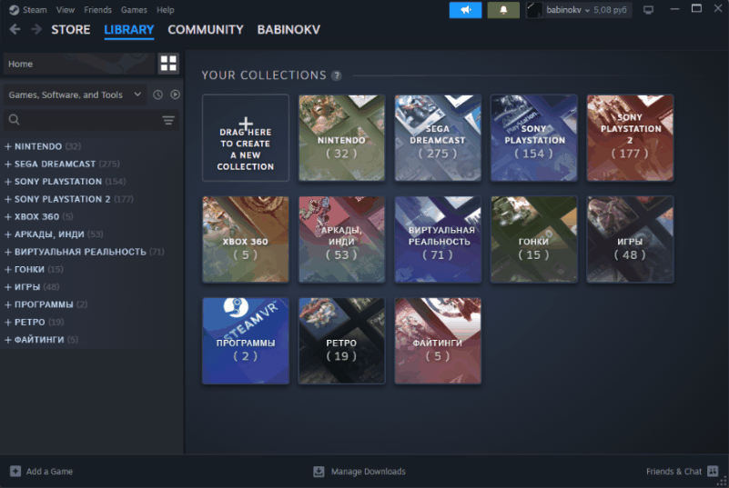
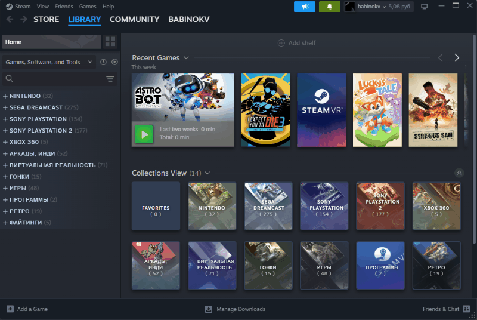
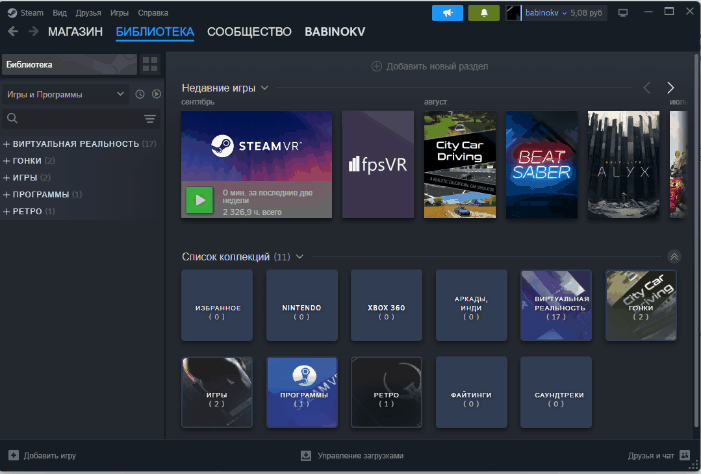
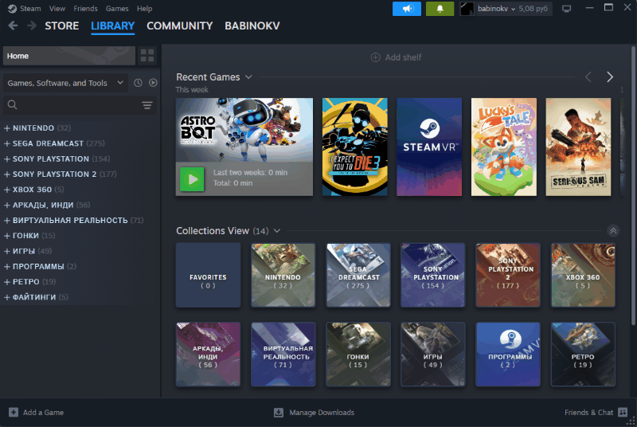
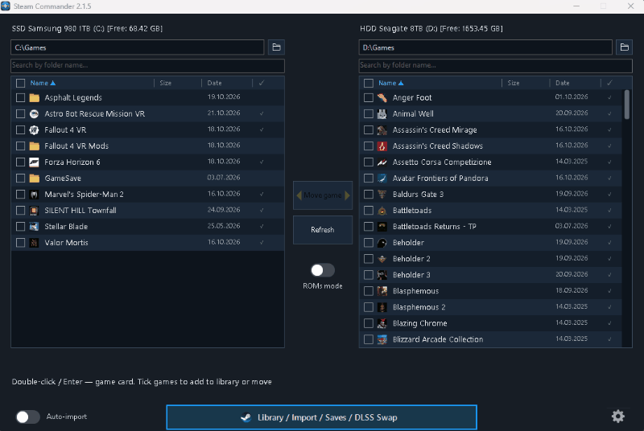
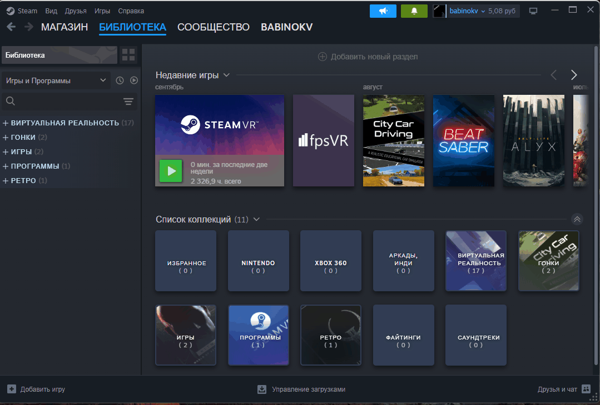

<div align="center">


# Steam Commander

**Всё для сторонних игр в Steam в одной программе: добавление игр и ROM-ов, импорт из Epic / GOG / Ubisoft / EA / Battle.net / Xbox, обложки (в том числе анимированные) из Steam и SteamGridDB, резервные копии сохранений, обновление DLSS / FSR / XeSS / XeLL и удобное перемещение игр между дисками.**


[](https://github.com/Hetfield1985/Steam-Commander/releases)

---

[](https://github.com/Hetfield1985/Steam-Commander/releases/latest)

<p align="center">
  <a href="https://donatty.com/vitalibabinok"></a>
  <a href="https://destream.net/live/VitaliBabinok"></a>
  <a href="https://boosty.to/babinok/donate"></a>
  <a href="#поддержка"></a>
</p>

<p align="center">
  <b>Русский</b> · <a href="README.md">English</a>
</p>

---

</div>

## Содержание

- [Что умеет программа](#что-умеет-программа)
- [Системные требования](#системные-требования)
- [Установка](#установка)
- [Первоначальная настройка](#первоначальная-настройка)
- [Горячие клавиши](#горячие-клавиши)
- [Где хранятся данные](#где-хранятся-данные)
- [Конфиденциальность и сеть](#конфиденциальность-и-сеть)
- [Известные ограничения](#известные-ограничения)
- [Поддержка](#поддержка)

---

## Что умеет программа

### Добавление игр в Steam

Добавление в библиотеку Steam сторонних (Non-Steam) игр с автоматическим определением названия, EXE-файла, удобным выбором официальных параметров запуска (или вводом своих) и полным набором обложек из двух источников: Steam и SteamGridDB. Можно добавлять игры по одной через карточку или пакетно: всё, в чём программа уверена, заполняется автоматически, а недостающее она уточняет у вас.

Встроенная база названий игр Steam нужна для более точного поиска. Она содержит данные об играх на момент создания программы; для точного поиска новинок рекомендуется получить свой Steam Web API-ключ и указать его в настройках.

Из карточки игру можно сразу запустить кнопкой **Запуск**: она стартует ровно то, что показано в карточке (выбранный EXE или эмулятор, ROM, параметры запуска), даже если игра ещё не сохранена.

<p align="center">
  
</p>

### Обложки: Steam, SteamGridDB и анимация

- **Два источника** — официальные обложки Steam (с выбором региона) и пользовательские из SteamGridDB, для четырёх слотов: вертикальная, горизонтальная, фон (hero) и логотип, плюс иконка.
- **Анимированные обложки.** Поддерживаются GIF, APNG и анимированный WebP: анимация играет в карточке, в плитках Library и в окне выбора SteamGridDB. Файл обложки при этом не меняется и передаётся Steam как есть (анимированные файлы сохраняются в `config\grid` под именем `.png`, так их понимает Steam). Для WebP программа один раз скачивает утилиты libwebp.
- **Окно выбора SteamGridDB.** Порядок «по популярности» совпадает с сайтом steamgriddb.com. Сортировка: по рейтингу, сначала новые, сначала старые, а для ROM — сначала обложки нужной платформы. Фильтры как на сайте: размеры, стили, языки, тип файла, теги (статичные, анимированные, юмор, 18+, эпилепсия). Варианты подгружаются по мере прокрутки, миниатюры скачиваются в фоне с повторами при сбоях.
- **Свои картинки.** Плитка «Выбрать свою» принимает PNG, JPG, GIF, APNG, WebP, ICO и другие форматы; иконки EXE игры предлагаются автоматически.
- **Логотип как в Steam.** Позиция и размер логотипа берутся у разработчика игры, а при ручной настройке логотип прилипает к пяти позициям Steam (с подсказками при перетаскивании). Кнопка обрамления показывает фон так, как его рисует клиент Steam.
- **Быстрая загрузка.** Из зеркал Steam CDN (akamai, fastly, cloudflare) автоматически выбирается самое быстрое, четыре обложки скачиваются параллельно.

<!-- Для этого раздела можно добавить: assets/screenshots/covers_animated.gif и assets/screenshots/sgdb_chooser.png -->

### Импорт из лаунчеров

Epic Games, GOG Galaxy, Ubisoft Connect, EA App, Battle.net, Xbox. Импорт отмеченных игр в Steam (ручной и автоматический); выбор можно набирать сразу из нескольких лаунчеров и импортировать одной кнопкой. Обложки настраиваются так же, как у обычных игр. Для запуска используется собственный тихий лаунчер: он следит, чтобы сторонний лаунчер стартовал в тихом режиме, переводит фокус на игру и закрывает сторонний лаунчер после выхода из игры. Ощущение такое, будто вы играете в обычную игру из Steam.

<p align="center">
  
</p>

### Автоматический импорт

Для тех, кто экономит время: при включённой опции автоимпорта игры добавляются большими пачками и очень быстро, без вашего участия. От вас потребуется только уточнить данные, которые программа не смогла определить с уверенностью.

<p align="center">
  
</p>

### Сохранения игр: резервные копии и восстановление

- **Поиск сохранений без запуска игры.** Пути берутся из официальной базы Ludusavi (лицензия MIT, встроена в программу, обновляется из настроек), из известных путей эмуляторов Steam (в том числе для не лицензионных копий игр), из Steam Cloud и по эвристике. Для игр, которых нет в базе, есть детектор: он запускает игру, следит за создаваемыми файлами и предлагает наиболее вероятные папки.
- **Резервное копирование и восстановление** — для одной игры (кнопки в карточке и пункты меню плитки) или для всех отмеченных игр сразу (группа **Сохранения** в окне Library). Копии хранятся в zip-архивах; если сохранения не менялись, новый архив не создаётся. Перед восстановлением текущие сохранения автоматически откладываются в страховочный архив `pre-restore`, а если копий несколько, можно выбрать нужную.
- Общая папка резервных копий выбирается в настройках. ROM-ы в этой функции не участвуют.

<!-- Для этого раздела можно добавить: assets/screenshots/saves_backup.gif -->

### Добавление ROM-ов с выбором эмулятора

Панели показывают папки и ROM-файлы по расширениям активного эмулятора. Менеджер эмуляторов, поддержка RetroArch с выбором ядра, архивы (zip, 7z, rar и др.) с распаковкой во временную папку, свои параметры запуска эмуляторов (например, полноэкранный режим). При изменении профиля эмулятора программа находит все использующие его ярлыки и предлагает обновить их разом. Эмулятор уже добавленных ROM-ов можно сменить в Library одним действием, не открывая карточку, а обложки SteamGridDB для ROM-ов подбираются с учётом платформы.

<p align="center">
  
</p>

### Обновление и управление библиотеками апскейлеров

Скачивание и выбор версий DLSS / FSR / XeSS / XeLL. Замена библиотек в выбранных играх (или во всех добавленных) одной кнопкой, по желанию автоматически при добавлении игры в Steam. По итогам операции показывается подробный отчёт по каждой игре. Оригиналы сохраняются как `.sc_orig`, восстановление одним действием.

<p align="center">
  
</p>

### Двухпанельный браузер

Две независимые панели (любые папки и диски). Поиск, сортировка, размер папок, отметка «уже в Steam» со значком игры. Перемещение папок игр и ROM-ов между панелями с прогрессом и автоматическим обновлением ярлыков Steam. Умное перемещение сразу в обе стороны между папками и дисками: отметьте игры на обеих панелях и нажмите пробел, чтобы узнать, возможно ли такое перемещение и сколько места не хватает.

<p align="center">
  
</p>

### Редактирование библиотеки

Редактирование Non-Steam игр, ROM-ов и лицензионных игр Steam (обложки, параметры запуска). Автоматическое и ручное резервное копирование и восстановление `shortcuts.vdf` (файл, в котором хранится библиотека сторонних игр). Режим перезапуска Steam в настройках: **автоматически** (программа сама закрывает и запускает Steam) или **вручную** (вы сами решаете, когда перезапустить Steam, а программа корректно запишет `shortcuts.vdf` после его закрытия).

<p align="center">
  
</p>

### Ещё

- Шесть языков интерфейса: Русский, English, 简体中文, Español, Português (Brasil), Deutsch; можно добавлять свои языковые файлы.
- Быстрый запуск и плавная работа с большими библиотеками: списки и плитки строятся порциями, прокрутка не подвисает, повторный старт ускоряется кешем скомпилированных блоков.
- Телеметрии нет.

---

## Системные требования

- Windows 10 или 11
- Windows PowerShell 5.1 (только при запуске `.ps1`)
- Установленный Steam (хотя бы один раз запущенный)
- **Права администратора**
- Интернет: для поиска игр, обложек, баз сохранений и скачивания апскейлеров
- Необязательно, но рекомендуется: [Steam Web API ключ](https://steamcommunity.com/dev/apikey), а для выбора пользовательских обложек настоятельно рекомендуется [SteamGridDB API ключ](https://www.steamgriddb.com/profile/preferences)
- Для ROM-архивов: 7-Zip (программа может предложить скачать)

---

## Установка

### Готовый exe
1. Скачайте `Steam Commander.exe` со страницы [Releases](../../releases)
2. Запустите (программа запросит права администратора)

### Скрипт
```powershell
# PowerShell от имени администратора
powershell -ExecutionPolicy Bypass -File .\src\Steam_Commander.ps1
```

### Сборка exe
```powershell
Install-Module ps2exe -Scope CurrentUser   # один раз
.\build\build.ps1
```
Результат: `dist\Steam Commander.exe`.

---

## Первоначальная настройка

1. Откройте **Настройки** и укажите папку Steam и профиль `userdata`
2. *(По желанию)* Добавьте Steam Web API и SteamGridDB API ключи
3. При необходимости скачайте библиотеки апскейлеров, обновите базу сохранений и выберите общую папку для резервных копий сохранений
4. Для ROM-ов добавьте профили эмуляторов с указанием exe
5. Выберите режим перезапуска Steam: автоматический или ручной

> При записи в `shortcuts.vdf` Steam должен быть закрыт: в автоматическом режиме программа закроет его и запустит снова. Перед операцией закройте игры и дождитесь синхронизации Steam.

---

## Горячие клавиши

| Клавиша | Действие |
|---|---|
| Двойной щелчок / **Enter** | Открыть карточку игры |
| **Space** | Размер папок отмеченных игр, а также проверка возможности переноса этих игр между панелями |
| **Ctrl+A** | Выбрать все папки и файлы в панели |
| **Esc** | Закрыть карточку игры или окно |
| **Alt+Shift+Enter** | Размер всех папок панели |
| **F5** | Обновить панели / окно библиотеки |

---

## Где хранятся данные

| Что | Где |
|---|---|
| Настройки, профили эмуляторов | `%APPDATA%\Steam Commander` |
| База игр Steam | `%APPDATA%\Steam Commander\steam_apps_db.json` |
| Библиотеки апскейлеров | `%APPDATA%\Steam Commander` |
| База сохранений (Ludusavi) | `%APPDATA%\Steam Commander\saves` |
| Резервные копии сохранений | папка, выбранная в настройках (по умолчанию `%APPDATA%\Steam Commander\saves\backups`) |
| Утилиты для WebP (libwebp), при необходимости ffmpeg | `%APPDATA%\Steam Commander\libwebp`, `%APPDATA%\Steam Commander\ffmpeg` |
| Кеш скомпилированных блоков | `%LOCALAPPDATA%\SteamCommander\typecache` |
| Языковые файлы | `%APPDATA%\Steam Commander\lang` |
| Резервные копии `shortcuts.vdf` | папка `backups` рядом с exe |
| Временные файлы | `%TEMP%\SteamCommander` |
| Ярлыки и обложки Steam | `Steam\userdata\<id>\config\` |

Ключи API хранятся в открытом виде в `config.ini`, не передавайте этот файл.

---

## Конфиденциальность и сеть

Телеметрии нет. Программа обращается только к:

- `store.steampowered.com`, `api.steampowered.com`, `*.steamstatic.com`, `steamcdn-a.akamaihd.net` (данные и обложки Steam)
- `api.steamcmd.net`
- `www.steamgriddb.com` и его CDN (обложки, при наличии ключа)
- `raw.githubusercontent.com` (свежая база сохранений Ludusavi, только по кнопке обновления) и `github.com`
- источникам библиотек апскейлеров DLSS Swapper
- `storage.googleapis.com` (утилиты libwebp для WebP, один раз), `www.7-zip.org` (7-Zip для архивов, по запросу), `www.gyan.dev` и `github.com` (ffmpeg, только если потребуется для WebM-превью)
- сервисам лаунчеров (GOG, Ubisoft, Microsoft Store) для названий и обложек импортируемых игр

---

## Структура проекта

```text
Steam-Commander/
├── src/Steam_Commander.ps1
├── build/build.ps1
├── assets/icon/
├── .github/
├── CHANGELOG.md
├── CONTRIBUTING.md
└── LICENSE
```

---

## Известные ограничения

- Для новых или малоизвестных игр обложки Steam могут отсутствовать: помогает поиск по базам SteamGridDB
- Сопоставление названий эвристическое; индикаторы уверенности подсказывают, когда данные нужно проверить вручную
- Импорт из лаунчеров зависит от формата данных конкретного лаунчера
- Поиск сохранений опирается на базу Ludusavi и эвристику: для редких игр путь, возможно, придётся подтвердить вручную
- Анимированные обложки декодируются в фоне, поэтому тяжёлые файлы начинают играть не сразу
- Только Windows

---

## Участие в разработке

Ошибки и pull request приветствуются, см. [CONTRIBUTING.md](CONTRIBUTING.md).  
Можно добавлять языковые файлы в папку `lang`. История изменений: [CHANGELOG.md](CHANGELOG.md).

---

## Отказ от ответственности

Steam Commander — неофициальный проект сообщества. Не связан с Valve Corporation.  
*Steam* и логотип Steam — товарные знаки Valve Corporation.  
Обложки принадлежат их владельцам. Иконка приложения — оригинальный дизайн.  
База сохранений основана на [Ludusavi Manifest](https://github.com/mtkennerly/ludusavi-manifest) (MIT).

Программа изменяет `shortcuts.vdf`, может заменять DLL апскейлеров и перезаписывать файлы сохранений при восстановлении. Используйте на свой страх и риск. Перед массовыми операциями создайте резервную копию.

---

## Лицензия

[MIT](LICENSE)

---

## Поддержка

Если программа оказалась полезной:

- [Donatty](https://donatty.com/vitalibabinok)
- [DeStream](https://destream.net/live/VitaliBabinok)
- [Boosty](https://boosty.to/babinok/donate)

**USDT** (минимум 5 USDT):

- ERC-20: `0x2503cdb205ac6e41222e114d77b0dcc48ed83686`
- TRC-20: `TSE4BZQC6h9qES2QsgJjcfyDbGYNDATSv4`
- BEP-20: `0x2503cdb205ac6e41222e114d77b0dcc48ed83686`

Отправляйте только через указанную сеть. Переводы меньше 5 USDT или через другую сеть будут потеряны.
